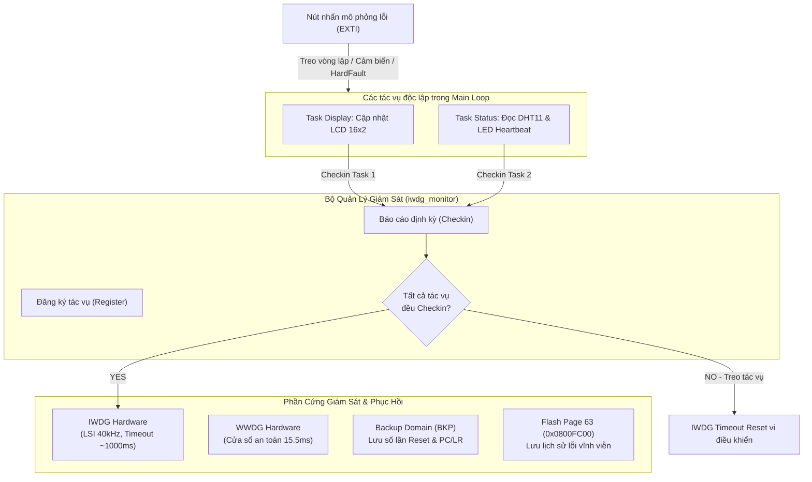

# WATCHDOG RECOVERY SYSTEM
### Hệ Thống Giám Sát và Tự Phục Hồi Đa Tác Vụ Sử Dụng Watchdog Timer trên STM32F103

---

## 1. Giới Thiệu Đề Tài

Trong các hệ thống nhúng hoạt động liên tục (24/7) như thiết bị y tế, IoT gateway công nghiệp hay trạm quan trắc môi trường, sự cố treo vi điều khiển (phần mềm rơi vào vòng lặp vô hạn, xung đột ngoại vi, nhảy con trỏ lệnh sai địa chỉ) là điều không thể tránh khỏi. Nếu không có cơ chế tự phục hồi, hệ thống sẽ ngừng hoạt động hoàn toàn và đòi hỏi can thiệp thủ công từ con người.

Đề tài **"Hệ thống giám sát và tự phục hồi dùng Watchdog Timer"** tập trung nghiên cứu, thiết kế và hiện thực hóa một giải pháp toàn diện trên nền tảng vi điều khiển **STM32F103C8T6 (ARM Cortex-M3)**:
- **Cơ chế Watchdog kép:** Kết hợp giữa **IWDG** (Independent Watchdog - chạy xung LSI nội độc lập, giải cứu hệ thống khi treo toàn phần) và **WWDG** (Window Watchdog - chạy xung APB1, giám sát cửa sổ thời gian bảo vệ luồng thực thi).
- **Kiến trúc giám sát đa tác vụ (Multi-task Checkin):** Khắc phục nhược điểm "nạp mù" của các hệ thống truyền thống; chỉ cho phép nạp lại IWDG khi **tất cả** các tác vụ con (Hiển thị LCD, Thu thập cảm biến/Trạng thái nền) đều hoàn thành và báo cáo trạng thái bình thường.
- **Chẩn đoán sự cố chuyên sâu & Hộp đen (Blackbox):** Tự động phát hiện nguyên nhân gây reset qua thanh ghi `RCC->CSR`, bộ đếm số lần tự phục hồi lưu trong Backup Domain (BKP), bẫy ngoại lệ **HardFault** trích xuất con trỏ lệnh `PC` và `LR`, đồng thời lưu trữ lịch sử 32 bản ghi sự cố vào ô nhớ **Flash nội (Page 63)** không bị mất dữ liệu khi mất nguồn.

---

## 2. Phân Công Công Việc Nhóm Sinh Viên

| STT | Họ và Tên | Mã Sinh Viên | Công việc đảm nhiệm |
|:---:|:---|:---:|:---|
| **1** | **Nguyễn Mạnh Hưng** | **DT070122** | **SV1:** Cấu hình IWDG, tính timeout; chiến lược nạp lại watchdog đúng chỗ (chỉ khi mọi tác vụ báo "khỏe"). |
| **2** | **Phạm Văn Toán** | **DT070146** | **SV2:** Mô phỏng lỗi bằng nút: treo vòng lặp, chờ cảm biến vô hạn, HardFault (truy cập địa chỉ sai). |
| **3** | **Nguyễn Nhật Minh** | **DT070133** | **SV3:** Đọc nguyên nhân reset (cờ RCC), bộ đếm reset trong backup register, hiển thị LCD. |
| **4** | **Giang Đức Quyết** | **DT070137** | **SV4:** Ứng dụng nền (đo nhiệt, LED heartbeat), UART log; thử WWDG để so sánh; báo cáo.<br><br>*(Phần mở rộng nâng cao)*: Lưu log lỗi vào Flash (Page 63); Trình phục vụ HardFault trích xuất và in giá trị PC/LR. |

---

## 3. Kiến Trúc và Tính Năng Kỹ Thuật



### 3.1. Các module chức năng chính
1. **Module `iwdg_monitor` (SV1):**
   - Đăng ký mặt nạ bit (`task_mask`) cho từng tác vụ độc lập.
   - Quản lý timeout IWDG: Prescaler 64, Reload 624 $\rightarrow$ Timeout thực tế $\approx 998\text{ ms}$ (chuẩn $40\text{ kHz}$) đến $665\text{ ms}$ (xấu nhất $60\text{ kHz}$).
   - Chỉ khi cả `TASK_ID_DISPLAY` và `TASK_ID_STATUS` đều gọi checkin trong chu kỳ thì bộ đếm IWDG mới được nạp lại (`HAL_IWDG_Refresh`).
2. **Module `mo_phong_loi` (SV2):**
   - **Nút PA0:** Mô phỏng vòng lặp vô hạn `while(1)` $\rightarrow$ làm treo luồng, ngăn tác vụ checkin $\rightarrow$ IWDG reset sau $\sim 1\text{ s}$.
   - **Nút PA1:** Mô phỏng nghẽn tín hiệu cảm biến không có cơ chế thoát $\rightarrow$ IWDG kích hoạt cứu hệ thống.
   - **Nút PA2:** Mô phỏng truy cập con trỏ sai địa chỉ (`*(0xFFFFFFF0)`) $\rightarrow$ kích hoạt lập tức bẫy ngoại lệ **HardFault**.
3. **Module `doc_loi` & `lcd` (SV3):**
   - Đọc cờ nguyên nhân khởi động trong `RCC->CSR` (Power-on, IWDG, WWDG, Soft Reset, Pin Reset).
   - Bộ đếm số lần phục hồi tự động lưu trong `BKP_DR1` (giữ nguyên giá trị qua reset).
   - Hiển thị LCD 16x2 qua I2C PCF8574T: Hiển thị nguyên nhân lỗi và số lần tự phục hồi trong 5 giây đầu, sau đó chuyển sang màn hình theo dõi nhiệt độ - độ ẩm thời gian thực.
4. **Module `system_status` & `temp_sensor` (SV4):**
   - Giao tiếp cảm biến DHT11 (PA8) sử dụng bộ định thời xung nhịp phần cứng **DWT Cycle Counter** (chuẩn micro-giây), tự động nhận diện chuẩn dữ liệu 8-bit và 16-bit.
   - Máy trạng thái **LED Heartbeat (PC13):**
     - `NORMAL`: Chớp 1Hz (chu kỳ bình thường).
     - `RECOVERED`: Nhấp nháy nhanh 10Hz trong 5 giây đầu sau khi vi điều khiển vừa tự phục hồi từ Watchdog.
     - `WARNING`: Nhấp nháy chớp kép khi nhiệt độ vượt ngưỡng hoặc cảm biến đọc lỗi.
     - `FAULT`: Sáng liên tục khi hệ thống rơi vào trạng thái nguy cấp.
   - Định dạng gửi log thời gian thực chi tiết qua UART1 (115200 8N1).
   - Tích hợp dịch vụ cửa sổ an toàn WWDG (`counter < window && counter >= 64U`), hỗ trợ nạp xen kẽ trong quá trình in chuỗi I2C LCD để tránh nghẽn luồng.

### 3.2. Tính năng mở rộng nâng cao
- **Trình xử lý ngoại lệ HardFault chuyên sâu (`stm32f1xx_it.c`):**
  - Viết bằng Assembly (`tst lr, #4; ite eq; mrseq r0, msp; mrsne r0, psp`) trích xuất chính xác khung ngăn xếp (Stack Frame).
  - Trích xuất con trỏ lệnh thực thi bị lỗi (**PC - Program Counter**) và thanh ghi liên kết (**LR - Link Register**).
  - Ghi tức thời vào `BKP_DR3..DR7`, xuất trực tiếp qua thanh ghi phần cứng USART1 không dùng ngắt, sau đó chờ IWDG kích hoạt reset an toàn.
- **Hộp đen ghi nhật ký vào Flash nội (`flash_log.c / .h`):**
  - Sử dụng trang nhớ cuối cùng của vi điều khiển (**Page 63, địa chỉ `0x0800FC00`**).
  - Cấu trúc bản ghi 16-byte: Số lần reset, nguyên nhân, mã lỗi, giá trị PC, giá trị LR, dấu thời gian.
  - Bộ nhớ lưu được tối đa 32 bản ghi lỗi liên tiếp với cơ chế màng chắn Magic Byte (`0xAA55`), không bị mất khi mất toàn bộ nguồn điện.

---

## 4. Sơ Đồ Nối Dây Phần Cứng (Pinout)

| Thiết bị / Module | Chân STM32F103C8T6 | Chế độ cấu hình | Chức năng |
|---|:---:|:---:|---|
| **Cảm biến DHT11** | `PA8` | GPIO Open-Drain / Input Pull-up | Đọc dữ liệu nhiệt độ - độ ẩm (giao thức 1 dây) |
| **Màn hình LCD 16x2 (I2C)** | `PB6` (SCL), `PB7` (SDA) | I2C1 (100 kHz) | Hiển thị thông số và nguyên nhân lỗi |
| **Mạch nạp & UART Serial** | `PA9` (TX), `PA10` (RX) | USART1 (115200 8N1) | Xuất nhật ký giám sát (log) lên máy tính |
| **Nút nhấn lỗi 1 (Loop)** | `PA0` | GPIO EXTI Falling Edge, Pull-up | Kích hoạt mô phỏng lỗi treo vòng lặp vô hạn |
| **Nút nhấn lỗi 2 (Sensor)**| `PA1` | GPIO EXTI Falling Edge, Pull-up | Kích hoạt mô phỏng lỗi chờ cảm biến vô hạn |
| **Nút nhấn lỗi 3 (HardFault)**| `PA2` | GPIO EXTI Falling Edge, Pull-up | Kích hoạt mô phỏng truy cập sai bộ nhớ |
| **LED Heartbeat** | `PC13` | GPIO Output Open-Drain | Đèn báo chỉ thị nhịp tim hệ thống (Active LOW) |

---

## 5. Cấu Trúc Thư Mục Dự Án

```
watchdog-recovery-system/
├── README.md                           # Giới thiệu đề tài, phân công & tài liệu tóm tắt
├── .gitignore                          # Cấu hình bỏ qua các file build tạm của Keil MDK
│
├── demo/
│   └── Video demo.md                   # Đường dẫn video demo kiểm thử thực tế trên kit
│
├── docs/
│   └── Báo Cáo Hệ Thống Nhúng.docx     # Báo cáo kỹ thuật chi tiết toàn diện
│
├── tests/
│   └── sv4_status_test.md              # Kịch bản kiểm thử tích hợp
│
└── firmware/
    └── watchdog-system/                # Mã nguồn STM32CubeMX & Keil MDK
        ├── Core/
        │   ├── Inc/                    # Các tệp Header (.h)
        │   │   ├── iwdg_monitor.h      # [SV1] Bộ giám sát đa tác vụ IWDG
        │   │   ├── mo_phong_loi.h      # [SV2] Bộ mô phỏng lỗi phần cứng EXTI
        │   │   ├── doc_loi.h           # [SV3] Đọc RCC, quản lý BKP Domain
        │   │   ├── lcd.h               # [SV3] Driver điều khiển LCD 16x2 I2C
        │   │   ├── system_status.h     # [SV4] Quản lý LED Heartbeat, UART log, WWDG
        │   │   ├── temp_sensor.h       # [SV4] Driver DHT11 (định thời DWT)
        │   │   ├── flash_log.h         # [Mở rộng] Lưu nhật ký lỗi vào Flash Page 63
        │   │   └── shared_types.h      # Kiểu dữ liệu và mã lỗi dùng chung
        │   │
        │   └── Src/                    # Các tệp mã nguồn C (.c)
        │       ├── main.c              # Khởi tạo hệ thống & Vòng lặp điều phối chính
        │       ├── iwdg_monitor.c      # Hiện thực Multi-task Checkin
        │       ├── mo_phong_loi.c      # Hiện thực bẫy nút nhấn gây sự cố
        │       ├── doc_loi.c           # Hiện thực phân tích cờ Reset & BKP
        │       ├── lcd.c               # Hiện thực giao tiếp I2C LCD
        │       ├── system_status.c     # Hiện thực Heartbeat & dịch vụ WWDG
        │       ├── temp_sensor.c       # Hiện thực giao thức 1-wire micro-giây
        │       ├── flash_log.c         # Hiện thực ghi/đọc Flash nội
        │       └── stm32f1xx_it.c      # Trình phục vụ ngắt & HardFault Handler
        │
        ├── MDK-ARM/                    # Project Keil uVision 5 (.uvprojx)
        └── watchdog-system.ioc         # File cấu hình phần cứng STM32CubeMX
```

---

## 6. Hướng Dẫn Biên Dịch & Nạp Code

### 6.1. Yêu cầu công cụ
- **IDE:** Keil MDK-ARM v5.28 trở lên (sử dụng trình biên dịch ARMCC v5.06).
- **Phần mềm nạp/giao tiếp:** ST-Link Utility hoặc STM32CubeProgrammer; Hercules Setup Utility hoặc TeraTerm.
- **Phần cứng:** Kit STM32F103C8T6 (Blue Pill), Mạch nạp ST-Link V2, Cảm biến DHT11, LCD 16x2 kèm module I2C PCF8574, 3 nút bấm kích mức thấp.

### 6.2. Các bước tiến hành
1. Mở project trong Keil MDK theo đường dẫn:  
   `firmware/watchdog-system/MDK-ARM/watchdog-system.uvprojx`
2. Nhấn **Build Target (`F7`)** để biên dịch dự án. Đảm bảo kết quả:  
   `0 Error(s), 0 Warning(s)`.
3. Kết nối kit STM32 với máy tính qua ST-Link V2, nhấn **Download (`F8`)** để nạp chương trình vào vi điều khiển.
4. Mở cổng COM tương ứng (ví dụ `COM17`) trên Hercules Terminal với thông số `115200 - 8 - None - 1 - None`.
5. Bấm nút Reset phần cứng hoặc các nút mô phỏng sự cố `PA0`, `PA1`, `PA2` để quan sát quá trình ghi log, bẫy lỗi và tự động hồi sinh hệ thống.
